  

###

 

###

<h1 data-importer="text" align="center">Welcome There☕👀;  I'm Pavan Bhosale😼;</h1>

###

<h3 data-importer="text" align="left">🧬Tech I have worked with (skills 😋) 🧪{</h3>

###

  
  
  
  
  
  
  
  
  
  
  
  
  
  
  
  
  
  
  
  
  
  
  
  
  

###

<h3 data-importer="text" align="left">}</h3>

###

 

  <picture>
    <source media="(prefers-color-scheme: dark)" srcset="https://raw.githubusercontent.com/pavan-bhosale/pavan-bhosale/pacman-output/pacman-contribution-graph-dark.svg">
    <source media="(prefers-color-scheme: light)" srcset="https://raw.githubusercontent.com/pavan-bhosale/pavan-bhosale/pacman-output/pacman-contribution-graph.svg">
    
  </picture>

###

###

<h3 data-importer="text" align="center">🧐 Figuring Out && Interests 🕵️‍♀️</h3>

###

  
  
  
  
  
  
  
  
  
  
  
  
  
  
  
  
  
  
  

 

###

<h3 data-importer="text" align="left">👀 Things I'm Into (interests) { •  Full-Stack Development  •  Artificial Intelligence  •  Problem Solving  • Open Source Contributions • Chocolate Pastries }</h3>

###

  

###

  

###

 

###

  
  

###

 

  

###
